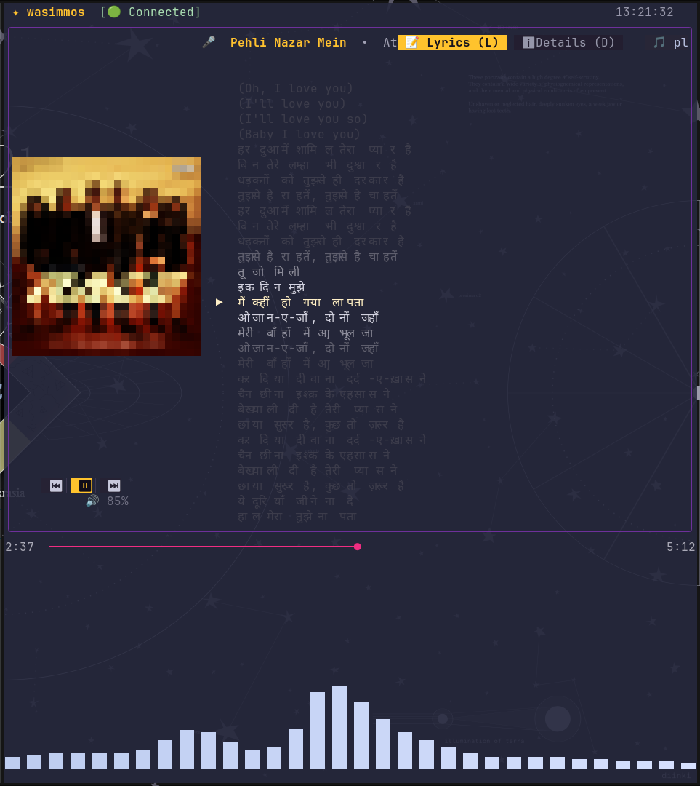

# ✦ spotif (wasimmos)

A lightning-fast, minimalist terminal music player with Spotify integration and real-time CAVA audio visualizer, built in Rust with [Ratatui](https://github.com/ratatui-org/ratatui).



---

## ✨ Features

- **60-FPS Real-Time Audio Visualizer**: Integrated with [CAVA](https://github.com/karlstav/cava) with Monstercat spatial smoothing, dynamic auto-gain (AGC), and direct PipeWire / PulseAudio speaker loopback sync.
- **Crystal-Clear Album Covers**: High-resolution cover art powered by the **Kitty Graphics Protocol** with automatic ANSI TrueColor half-block (`▀`) fallback for standard terminal emulators.
- **Synced Karaoke Lyrics & Track Details**: View live scrolling lyrics synchronized with playback, or hit `d` to switch to detailed song metadata (Release year, Genre, Audio format, Bitrate, and Up next).
- **Global CLI Command (`spotif`)**: Launch from anywhere in your terminal. Includes built-in `spotif --help` and `spotif --version`.
- **Interactive Mouse Seeking**: Click anywhere along the middle progress bar to seek instantly.
- **Collapsible Playlist Explorer**: Browse and live-filter (`/`) your Spotify playlists in a modal window.
- **Dynamic Color Themes**: Cycle themes on the fly (`t` / `m`) between *Disco Ice*, *Cyberpunk Neon*, *Sunset Horizon*, *Matrix Emerald*, and more.
- **Zero-Friction PKCE Authentication**: Secure OAuth 2.0 PKCE login with persistent token auto-refresh cached in `~/.config/spotif/`.

---

## 🚀 Installation Guide (Any Linux Device)

Follow these steps to build and run `spotif` on any Linux machine (Ubuntu, Debian, Arch Linux, Fedora, Manjaro, openSUSE, etc.).

### 1. Install System Dependencies

Install the basic audio tools and development headers:

#### **Ubuntu / Debian / Linux Mint**
```bash
sudo apt update
sudo apt install -y git curl pkg-config libasound2-dev libssl-dev cava pulseaudio-utils
```

#### **Arch Linux / Manjaro**
```bash
sudo pacman -S --needed git curl pkgconf alsa-lib openssl cava pipewire-pulse
```

#### **Fedora / RHEL**
```bash
sudo dnf install -y git curl pkgconf alsa-lib-devel openssl-devel cava pulseaudio-utils
```

> [!TIP]
> If `cava` is not packaged in your distribution's main repository, `spotif` includes a high-performance built-in FFT fallback engine that works automatically. Installing `cava` enables native Monstercat spatial wave smoothing.

---

### 2. Install Rust Toolchain

If you do not have Rust and Cargo installed, install them using `rustup`:

```bash
curl --proto '=https' --tlsv1.2 -sSf https://sh.rustup.rs | sh
source "$HOME/.cargo/env"
```

---

### 3. Clone & Build

Clone the repository and compile the release binary:

```bash
git clone https://github.com/wasimmos/spotify-terminal.git
cd spotify-terminal
cargo build --release
```

---

### 4. Install `spotif` to Your PATH

Copy the compiled binary into your local user binary directory so you can run `spotif` from any directory:

```bash
mkdir -p ~/.local/bin
cp target/release/spotif ~/.local/bin/spotif
chmod +x ~/.local/bin/spotif
```

Ensure `~/.local/bin` is in your shell `$PATH`. If it isn't already, add it to your `~/.bashrc` or `~/.zshrc`:

```bash
echo 'export PATH="$HOME/.local/bin:$PATH"' >> ~/.bashrc
source ~/.bashrc
```

Verify the installation:
```bash
spotif --version
spotif --help
```

---

## 🔑 Spotify API Setup (One-Time Setup)

`spotif` connects to Spotify's official Web API using free PKCE authentication.

### Step 1: Create a Spotify Developer App
1. Go to the [Spotify Developer Dashboard](https://developer.spotify.com/dashboard) and log in with your Spotify account.
2. Click **Create app**.
3. Fill in the details:
   - **App name**: `spotif` (or any name you prefer)
   - **App description**: `Terminal music player`
   - **Redirect URIs**: `http://localhost:8888/callback`  *(Important: must match exactly!)*
   - Which API/SDKs are you planning to use: Select **Web API**.
4. Click **Save**.

### Step 2: Configure Your Credentials
Go to your app's **Settings** tab and copy your **Client ID**.

Save it to your configuration directory:

```bash
mkdir -p ~/.config/spotif
cat << 'EOF' > ~/.config/spotif/.env
SPOTIFY_CLIENT_ID="your_spotify_client_id_here"
SPOTIFY_REDIRECT_URI="http://localhost:8888/callback"
EOF
```

*(Replace `your_spotify_client_id_here` with your actual Client ID)*.

---

## 🎧 First-Time Usage

Simply open a terminal and run:

```bash
spotif
```

1. On the very first launch, a browser window will open automatically asking you to authorize your Spotify account.
2. Click **Agree**.
3. The authorization token is automatically stored in `~/.config/spotif/token_cache.json`.
4. Return to your terminal — `spotif` is now connected and will remember your session!

---

## ⌨️ Controls & Keybindings

### **Playback**
| Key | Action |
| :--- | :--- |
| `Space` | Play / Pause current track |
| `s` | Stop playback |
| `n` | Skip to next track |
| `p` | Skip to previous track |
| `+` / `=` | Increase volume (+5%) |
| `-` | Decrease volume (-5%) |
| `Mouse Click` | Click on the middle progress bar to seek directly to that timestamp |

### **Views & Interface**
| Key | Action |
| :--- | :--- |
| `l` or `d` | Toggle right card mode: **Synced Karaoke Lyrics** ↔ **Track Details** |
| `Tab` or `P` | Open / Close collapsible Playlist Browser |
| `t` or `m` | Cycle color theme (*Disco Ice*, *Neon Sunset*, *Emerald Matrix*, *Cyberpunk*, etc.) |
| `q` or `Esc` | Quit cleanly |

### **Playlist Navigation** (when playlist modal is open)
| Key | Action |
| :--- | :--- |
| `j` / `↓` | Select next playlist |
| `k` / `↑` | Select previous playlist |
| `Enter` | Confirm and load playlist |
| `/` | Search / filter playlists |
| `Esc` | Close playlist modal |

---

## 📁 Configuration & Cache Structure

All settings and tokens are kept cleanly inside `~/.config/spotif/`:

```
~/.config/spotif/
├── .env                 # Your Spotify Client ID and Redirect URI
├── token_cache.json     # Auto-refreshed OAuth tokens (secure)
├── cava.conf            # Auto-generated CAVA visualizer configuration
└── current_cover.png    # Cached high-res album art
```

---

## 🛠️ Troubleshooting

- **Visualizer is flat or not moving**:
  Make sure music is playing through your default audio sink (speakers or headphones). On Linux systems running PipeWire or PulseAudio, ensure `cava` or `pulseaudio-utils` (`parec`) is installed.
- **Album cover art is blurry**:
  Use a terminal emulator that supports the Kitty Graphics Protocol (such as [Kitty](https://sw.kovidgoyal.net/kitty/), [Ghostty](https://ghostty.org/), or [WezTerm](https://wezfurlong.org/wezterm/)) for 100% native pixel-perfect album art rendering. Other terminals automatically fall back to ANSI half-block rendering.
- **Spotify status says "Connecting..."**:
  Verify your internet connection and that your `.env` contains the correct `SPOTIFY_CLIENT_ID`. You can reset authorization anytime by deleting `~/.config/spotif/token_cache.json`.

---

## 📄 License

Distributed under the MIT License. Built with ❤️ for terminal music lovers.
